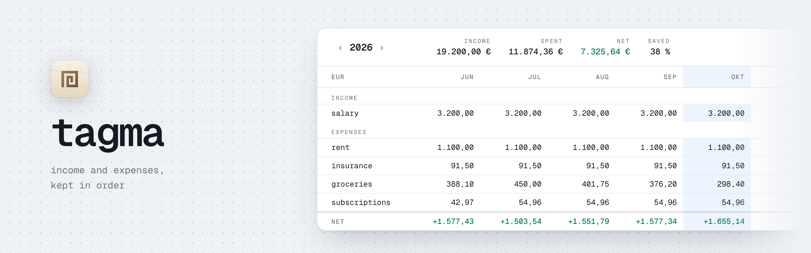

<picture>
    <source media="(prefers-color-scheme: dark)" srcset="docs/banner-dark.png">
    
</picture>

# tagma

A small, local tool for tracking personal income and expenses. You record each
entry with a category, and the main view is a year sheet: categories down the
side, months across the top, and totals for income, spending and net at the
bottom.

## Quickstart

Needs Node 22, Docker, and any `yarn` on the PATH. The Yarn release is
committed in `.yarn/releases`.

```bash
cp .env.example .env
yarn install
yarn db:up        # Postgres 18 in Docker, on localhost:5442
yarn db:migrate   # schema plus default categories and preferences
yarn dev          # http://localhost:3000
```

## Using it

- **N** or **+ new entry** opens the entry form. To create a new category,
  type its name into the category field.
- The name field unlocks once a category is picked. It suggests the names
  already used in that category, most used first, along with each one's last
  amount. ↑/↓ moves through the list, Enter picks a name, Escape closes the
  list. Picking a name fills in its last amount if the amount field is empty.
  A typed name that matches an existing one apart from capitalisation or
  spacing is saved with the existing spelling.
- **categories** in the header opens the category manager. There you can
  add, rename, reorder or switch a category between income and expenses. A
  category with entries can't be deleted: move its entries to another category
  or delete them first.
- Click a month header to open that month's entries. Click a cell to see only
  that category. Click an entry to edit or delete it.
- The ⚙ popover sets the currency and the number and date format. These are
  stored in the `preferences` table. Changing the currency relabels amounts and
  does not convert them.

## Data

| Table         | Holds                                                                    |
| ------------- | ------------------------------------------------------------------------ |
| `categories`  | name and kind (`income`/`expense`); unique per kind, case-insensitive    |
| `entries`     | name, category, `amount_cents` (always positive), `occurred_on` (a date) |
| `preferences` | one row: `currency`, `locale`                                            |

The category's kind decides whether an entry counts as income or as an
expense. The data lives in the `tagma-pg` Docker volume.

Schema changes: edit `src/lib/db/schema.ts`, run `yarn db:generate`, review
the SQL in `drizzle/`, then run `yarn db:migrate`. `yarn db:studio` opens
Drizzle Studio.

## Scripts

| Script                   | Does                                  |
| ------------------------ | ------------------------------------- |
| `yarn dev` / `build`     | Next.js dev server / production build |
| `yarn test`              | Vitest unit tests                     |
| `yarn verify`            | typecheck, lint, test and build       |
| `yarn db:up` / `db:down` | start / stop Postgres                 |

## Layout

| Path                        | Contents                                                     |
| --------------------------- | ------------------------------------------------------------ |
| `src/app/`                  | the route (`page.tsx`), layout, global styles and tokens     |
| `src/features/sheet/`       | year aggregation, sheet queries, table and header            |
| `src/features/entries/`     | entry dialog, form, category combobox, month drawer, actions |
| `src/features/categories/`  | category manager dialog, queries, actions, reordering        |
| `src/features/preferences/` | currency/locale popover, query and action                    |
| `src/lib/`                  | DB client and schema, money and date helpers                 |
| `src/schemas/`              | Zod schemas and shared types                                 |
| `src/components/ui/`        | shadcn primitives (generated; not hand-edited or linted)     |
| `drizzle/`                  | SQL migrations; `0001_seed.sql` holds the default categories |

Reads happen in server components and writes go through server actions, which
call `refresh()`. There is no client-side data cache.
